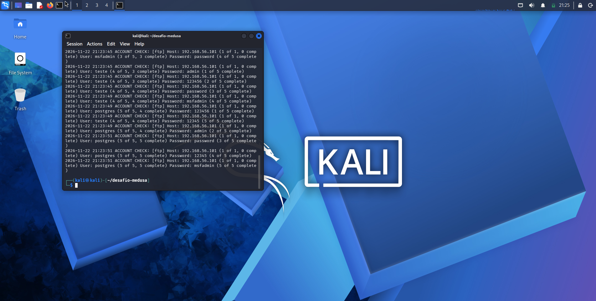
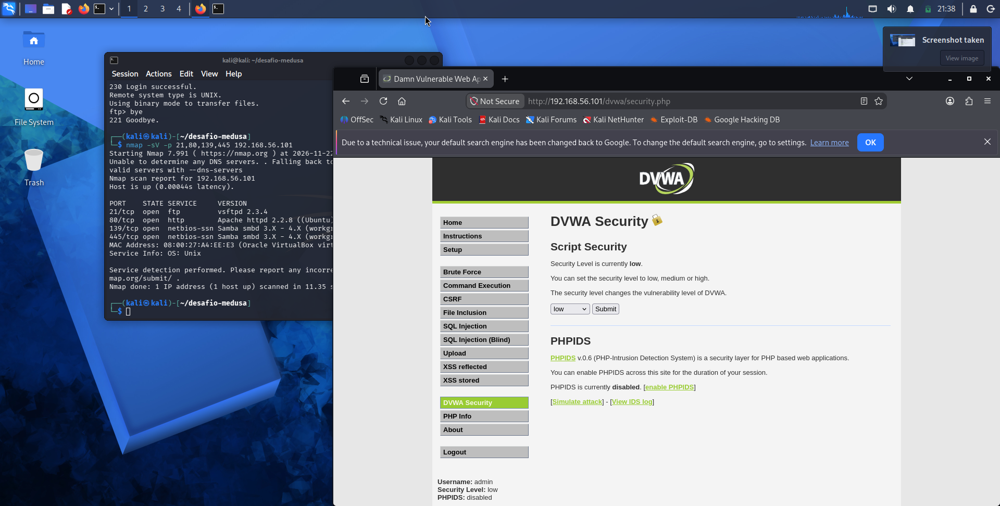

# Auditoria de Credenciais e Análise de Autenticação em Ambiente Controlado (DIO)

Este repositório documenta o laboratório prático desenvolvido como parte do desafio de Cibersegurança da **Digital Innovation One (DIO)**. O projeto demonstra a arquitetura de um ambiente virtualizado isolado para avaliação de políticas de senha fracas, análise de tráfego HTTP e aplicação de medidas defensivas contra ataques automatizados de autenticação.

> **Aviso Ético:** Todas as atividades descritas neste documento foram executadas exclusivamente em ambiente virtualizado local e isolado (*Host-Only*), sem conexão com redes externas ou sistemas de terceiros.

---

## 1. Arquitetura do Ambiente

O laboratório foi estruturado no **Oracle VirtualBox** utilizando uma rede privada **Host-Only** (`192.168.56.0/24`) para garantir total isolamento:

* **Máquina de Análise (Atacante):** Kali Linux (`192.168.56.102`)
* **Máquina Alvo:** Metasploitable 2 (`192.168.56.101`)

### Estrutura do Repositório

```text
desafio-medusa/
├── images/
│   ├── 01-nmap-scan.jpg
│   ├── 02-medusa-ftp.jpg
│   ├── 03-ftp-validacao.jpg
│   ├── 04-dvwa-security-low.jpg
│   ├── 05-dvwa-cookies.jpg
│   └── 06-dvwa-http-headers.jpg
├── wordlists/
│   ├── users.txt
│   └── passwords.txt
└── README.md

---

## 2. Reconhecimento e Enumeração Inicial (Nmap)

Antes de qualquer teste de autenticação, foi realizada a identificação dos serviços ativos e versões expostas na máquina alvo (`192.168.56.101`):

    nmap -sV -p 21,80,139,445 192.168.56.101

**Resultados identificados:**
- **Porta 21/tcp (FTP):** `vsftpd 2.3.4`
- **Porta 80/tcp (HTTP):** `Apache httpd 2.2.8 ((Ubuntu) DAV/2)`
- **Portas 139/445/tcp (SMB):** `Samba smbd 3.X - 4.X`


---

## 3. Auditoria de Credenciais em Serviço FTP (Medusa)

Para validar o risco de uso de credenciais padrão e dicionários reduzidos em serviços sem bloqueio de tentativas, foram criadas listas personalizadas (`wordlists/users.txt` e `wordlists/passwords.txt`) e executado o **Medusa**:

    medusa -h 192.168.56.101 -U wordlists/users.txt -P wordlists/passwords.txt -M ftp

O teste identificou a combinação válida `msfadmin:msfadmin`, confirmada posteriormente por meio de autenticação manual via cliente FTP:




---

## 4. Análise de Autenticação Web (DVWA)

No servidor Apache (`http://192.168.56.101/dvwa`), o ambiente **DVWA (Damn Vulnerable Web Application)** foi configurado com nível de segurança **Low** para observar o comportamento do protocolo HTTP durante tentativas de login:



Através das ferramentas de desenvolvedor do navegador (*DevTools*), foi possível inspecionar:
1. **Gerenciamento de Sessão:** Identificação do cookie `PHPSESSID` e do parâmetro `security=low` armazenados no navegador.
2. **Requisições HTTP:** Observação de envio de credenciais via método `GET` na URL (`/dvwa/vulnerabilities/brute/?username=...&password=...&Login=Login`), evidenciando ausência de proteção contra automação (*rate limiting* ou *CAPTCHA*) e exposição de parâmetros em logs de acesso.


---

## 5. Análise Conceitual de SMB e Password Spraying

Durante o reconhecimento das portas `139` e `445` (Samba), analisou-se o risco da técnica de **Password Spraying** em ambientes corporativos. Diferente da força bruta tradicional (que testa múltiplas senhas contra um único usuário e dispara bloqueios rapidamente), o *Password Spraying* testa **uma única senha comum** contra **diversos usuários** em intervalos espaçados, contornando políticas simples de *Account Lockout*.

---

## 6. Medidas Defensivas e Mitigação (Hardening)

Para mitigar os vetores explorados neste laboratório em ambientes de produção, recomendam-se os seguintes controles:

| Vetor / Serviço | Vulnerabilidade Observada | Medida de Mitigação Recomendada |
| :--- | :--- | :--- |
| **FTP (`vsftpd`)** | Credenciais padrão fracas e tráfego em texto claro | Substituir FTP por **SFTP** ou **FTPS**, desativar contas padrão e exigir senhas complexas. |
| **Autenticação (Geral)** | Tentativas ilimitadas de login automatizado | Implementar bloqueio temporário por IP/conta (**Fail2Ban** ou políticas de *Account Lockout*) e **MFA (Autenticação Multifator)**. |
| **Aplicação Web (DVWA)** | Envio de credenciais via `GET` e falta de limitação | Utilizar exclusivamente método `POST` sobre **HTTPS (TLS)**, aplicar *rate limiting*, *CAPTCHA* após falhas e flags `HttpOnly`/`Secure` nos cookies. |
| **SMB (Portas 139/445)** | Exposição de serviço de arquivos na rede | Desabilitar SMBv1, restringir sessões nulas (*Null Sessions*), segmentar acesso via firewall e monitorar eventos de falha de autenticação. |
